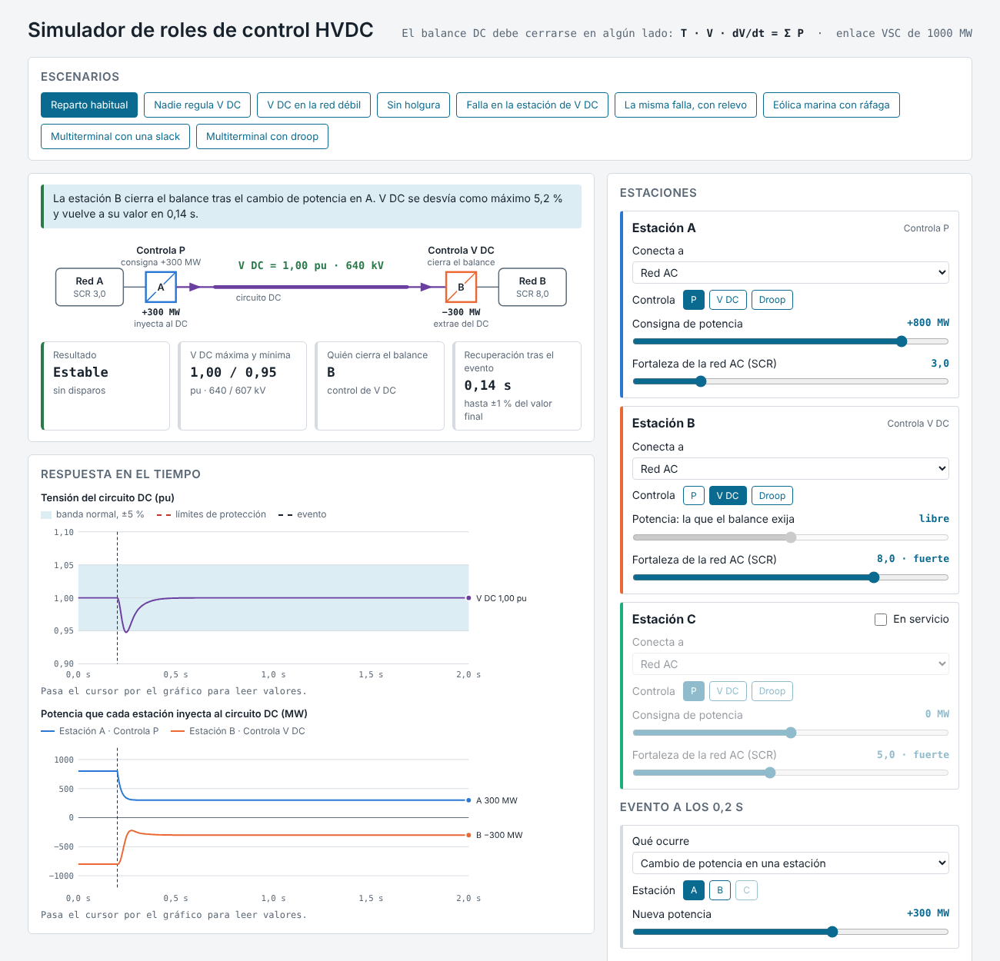

# Simulador de roles de control HVDC

Simulador interactivo para observar cómo se comporta un enlace HVDC según qué estación controla la potencia y cuál controla la tensión DC, y qué ocurre ante distintas condiciones del sistema.

**[Abrir el simulador](https://ajrcjf-web.github.io/hvdc-control-roles-simulator/)** · **[Leer la guía de conceptos (PDF)](https://ajrcjf-web.github.io/hvdc-control-roles-simulator/docs/roles_de_control_HVDC_conceptos.pdf)**



## Objetivo

El balance de potencia en el lado DC debe cerrarse en algún lado:

```
T · V_DC · dV_DC/dt = Σ P
```

La estación que controla la tensión DC absorbe cualquier desbalance y las demás entregan lo que se les ordena. El simulador permite cambiar ese reparto y ver dónde se rompe: red débil, falta de holgura, falla en la estación de tensión, eólica marina o un sistema multiterminal.

## Qué incluye

| Archivo | Contenido |
|---|---|
| `index.html` | El simulador completo en un solo archivo. No requiere instalación ni servidor. |
| `docs/roles_de_control_HVDC_conceptos.pdf` | Guía de 6 páginas: la regla del balance, los modos de control, los criterios de reparto y los usos del simulador. |

## Funcionamiento básico

Un enlace VSC de 1000 MW con hasta tres estaciones sobre un mismo circuito DC.

| Elemento | Opciones |
|---|---|
| Modo de cada estación | Control de P, control de V DC o droop |
| A qué se conecta | Red AC, parque eólico marino o carga aislada (en los dos últimos la estación forma la red) |
| Fortaleza de la red AC | SCR de 1,2 a 10 |
| Evento a los 0,2 s | Cambio de potencia, falla AC de 150 ms o pérdida de una estación |
| Respaldo | Relevo automático del control de V DC y chopper DC |

El resultado son dos gráficos de dos segundos (tensión DC y potencia de cada estación), un esquema con el estado final y un veredicto en palabras. Nueve escenarios cargan los casos más instructivos.

| Escenario | Qué muestra |
|---|---|
| Reparto habitual | La estación de V DC sigue los cambios sin recibir ninguna orden |
| Nadie regula V DC | Dos consignas que no suman cero llevan al disparo |
| V DC en la red débil | Con SCR 1,5 la estación de tensión no alcanza a cerrar el balance |
| Sin holgura | La estación de tensión llega a su límite de corriente |
| Falla en la estación de V DC | Sobretensión en menos de 0,1 s; con relevo, el enlace sobrevive |
| Eólica marina con ráfaga | La potencia del parque no es una orden; la estación de tierra cierra el balance |
| Multiterminal con una slack y con droop | Qué pasa al perder una estación en cada esquema |

### Modelo

- Circuito DC de un solo nudo con T = 0,12 s.
- Cada convertidor es un lazo de corriente de primer orden, con límite de 1,1 pu.
- Control de V DC proporcional-integral; droop del 5 %; relevo por banda de ±8 %; chopper a partir de 1,12 pu.
- Red débil: constante de tiempo `τ = 4 ms · (1 + 10/SCR)` y tensión en el punto de conexión `u = 1 − 0,3·|i|/SCR`.
- Disparo si V DC sale de 0,7 a 1,3 pu.

## Consideraciones y límites

- **Es una herramienta didáctica, no de estudio.** Las ganancias, la energía del circuito y los límites son ilustrativos.
- **La red débil está simplificada.** Se ve como lentitud y falta de capacidad; no reproduce las inestabilidades reales de las redes débiles (interacción con el PLL).
- **Sin cables.** No hay resistencia ni dinámica de línea, así que todas las estaciones ven la misma tensión DC.
- **Es un enlace VSC.** El caso LCC, donde los papeles se intercambian con el sentido del flujo, se explica en la guía pero no se simula.
- **No incluye** potencia reactiva, bloqueo de convertidores, fallas DC ni arranque en negro.

## Uso local

Descarga `index.html` y ábrelo en cualquier navegador moderno. Necesita conexión solo para cargar las tipografías; sin ella funciona igual con las del sistema.

## Proyectos relacionados

- [Simulador de flujo de potencia AC](https://github.com/ajrcjf-web/ac-power-flow-simulator)
- [Simulador HVDC: LCC frente a VSC](https://github.com/ajrcjf-web/hvdc-lcc-vs-vsc-simulator)

## Créditos

Desarrollado con asistencia de Claude (Anthropic).

## Licencia

MIT. Ver [LICENSE](LICENSE).
